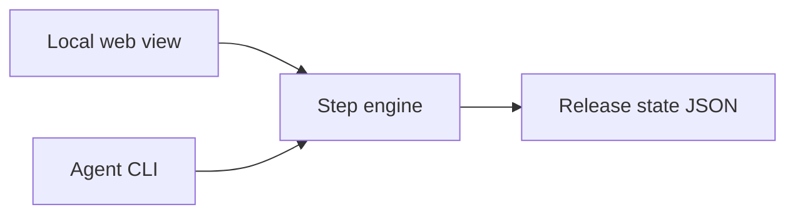

# Release runner

Local release orchestration for PublishPress plugins. Replaces the GitHub issue checklist and the prototype Clack `composer deploy` wizard.

**Implementation (for now):** this repository.

| Path | Role |
|------|------|
| [scripts/release-runner/](../../scripts/release-runner/) | CLI, engine, UI, state |
| [scripts/release-runner/steps/](../../scripts/release-runner/steps/) | Step definitions used by presets |
| [test/release-runner-*.test.mjs](../../test/) | Node tests |

Later: move into `publishpress/dev-workspace` and drop the duplicate tree here.

**Checklist sources:**

- [release-free-plugin.md](../../.github/ISSUE_TEMPLATE/release-free-plugin.md)
- [release-pro-plugin.md](../../.github/ISSUE_TEMPLATE/release-pro-plugin.md)

## Goals

- Resume, reset, or start a new release from saved state on one machine.
- Execute automatable steps; stop on human gates.
- React page on `127.0.0.1` shows the checklist and live log.
- CLI is the only writer; agents use `composer deploy -- <command>`.
- No release checklist GitHub issue; translator assignment issues stay manual outside the app.

## Architecture



- **State:** `dev-workspace-cache/releases/` (gitignored). One `current` pointer per plugin working copy.
- **CI:** not supported in v1. Releases run on developer machines.
- **Presets:** Listed in `composer.json` → `extra.release-presets` (array of preset ids). Legacy ids `free` / `pro` still resolve in saved state and CLI. If `release-presets` is omitted, a single stable preset is inferred (pro vs free heuristics). CLI `--preset` selects among listed presets; `--edition` is a deprecated alias.

## State

| Path | Purpose |
|------|---------|
| `dev-workspace-cache/releases/current.json` | Pointer to active release id |
| `dev-workspace-cache/releases/<version>.json` | Release record |
| `dev-workspace-cache/releases/archive/<version>.json` | Abandoned releases |

### Record fields

| Field | Type | Notes |
|-------|------|-------|
| `version` | string | Semver, e.g. `4.11.0` or `4.11.0-beta.1` |
| `edition` | preset id string | Canonical preset id (e.g. `plugin-free-stable`, `plugin-free-unstable`) |

Set available presets in the plugin root `composer.json`:

```json
"extra": {
  "release-presets": ["plugin-free-stable", "plugin-free-unstable"]
}
```

Stable presets (`*-stable`): start version must be `MAJOR.MINOR.PATCH` only. Unstable presets (`*-unstable`): base `x.y.z` only; package suffix from `prerelease` state (`beta` / `rc`).

| `urgency` | `standard` \| `security` | Label only; does not change steps |
| `branchName` | string | `release-<version>` |
| `status` | `in_progress` \| `abandoned` \| `complete` | |
| `prerelease` | `{ channel: beta\|rc, n: number }` | Bumps on package reopen |
| `steps` | map | Per step: `pending` \| `done` \| `skipped` \| `failed`, `at`, optional `note` |

### Lifecycle

- **`start`** — Create record; refuse if `current` is already `in_progress`.
- **`resume`** — Load `current`; error if missing.
- **`reset --yes`** — Delete current record and pointer. No git changes.
- **`new <version>`** — Archive current as `abandoned`, then `start` the new version.
- **`reopen <step>`** — Step and all later steps → `pending`. Reopening the package step increments `prerelease.n` on next build.

One in-progress release per working copy. A second concurrent release needs another clone.

## Commands

`--json` prints one object on stdout. Logs: stderr and `dev-workspace-cache/deploy.log`.

| Entry | Command |
|-------|---------|
| Page | `composer deploy` (runs on the **host**, not inside the dev-workspace container) |
| CLI | `composer deploy -- <subcommand> [options]` |

Composer only forwards arguments after `--`.

| Subcommand | Description |
|------------|-------------|
| `status [--json]` | Current release and step states |
| `start <version> [--preset <id>] [--edition <id>] [--urgency standard\|security] [--prerelease-channel beta\|rc]` | New release (`--preset` required when multiple ids in `extra.release-presets`; unstable presets auto-increment `prerelease.n`) |
| `resume` | Alias for loading current (no-op if already loaded) |
| `reset --yes` | Delete state |
| `new <version> …` | Archive + start |
| `list` | Current + archived ids |
| `complete <step> [--note]` | Mark manual step done |
| `skip <step> [--note]` | Skip step |
| `reopen <step>` | Cascade pending |
| `run [--until <step>] [--confirm <step>]` | Run auto steps |

### Exit codes (agents)

| Code | Meaning |
|------|---------|
| `0` | Pipeline complete for this `run` |
| `1` | Auto step failed |
| `10` | Stopped on manual or confirm gate; JSON includes `{ "blocked": "<step-id>" }` |

## Step model

| Type | Behavior |
|------|----------|
| `auto` | `run` executes shell/composer actions |
| `manual` | Stops with exit `10`; cleared with `complete` or `skip` |
| `confirm` | Stops with exit `10`; publish steps need `run --confirm <step>` |

### Publish boundary

Bare `run` may push the release branch and open the PR. It **stops before**:

- merge release branch → `master`
- GitHub release / tag (triggers deploy)

Those are `confirm` steps.

### GitHub auth

First preflight step: `github_auth`. Not skippable.

If `gh auth status` fails, run `gh auth login --hostname github.com --git-protocol https --web` under a PTY, then `gh auth setup-git`. Page shows wait state. No token field in the UI.

### Beta / RC loop

No repeat-block in the preset. Second package: `reopen` on the build/package step; later steps reset; `prerelease.n` bumps. Channel set at `start` or `reopen`, not inferred.

### Preset ids

| Preset | Purpose |
|--------|---------|
| `plugin-free-stable` | Full free release: milestones, WP.org check, post-release verification. |
| `plugin-pro-stable` | Full pro release: milestones, package-server check, pin free lib. |
| `plugin-free-unstable` | Beta/rc free: skips milestones, post-release, and WP.org gates. |
| `plugin-pro-unstable` | Beta/rc pro: skips milestone check/close only. |

### Preset gaps vs prototype

Presets follow the issue templates, not the old Future-only `custom-deploy` list:

- **Free:** `check:release` before tag; `check:wporg` after deploy.
- **Pro:** Pin Free in `lib/composer.json` to released tag; no `check:wporg`; package-server post-check.
- Two translator gates (ES/FR/IT and PT-BR).
- Milestone check at start; close at end.
- Tag name = plugin `Version` header (`4.11.0`, not `v4.11.0`).
- PR base = `master`.

## UI

- **Stack:** Vite + React, one page, no router.
- **Radix:** `Dialog`, `Collapsible` only. Buttons, log, layout: local CSS.
- **Not:** `@wordpress/components`, MUI, Ant, Chakra.

**Design system:** [release-runner-design/](release-runner-design/README.md) — tokens, components and copy rules for this page. Read it before changing the UI.

### Presets (UI vs CLI)

**Start release** lists presets from `GET /api/status` → `runnerPresets` and `presetMeta` (version rules, allowed prerelease channels). The dialog picks a preset; when more than one channel is allowed for that preset, a beta/rc control appears. Version validation follows the preset (`stable` = strict `x.y.z`).

CLI `composer deploy -- start <version> [--preset <id>]` uses the same rules. With a single entry in `extra.release-presets`, `--preset` may be omitted.

### Layout

1. Sticky header: version, edition, urgency, branch, prerelease, `gh` account. One primary action for the current step.
2. Phases as headings; steps as rows (collapsed except current).
3. Current step expanded: instructions + live log (SSE).
4. Security urgency: warning line in header.

Page calls the same engine functions as the CLI. After **start**, **complete**, **skip**, or **reopen**, the runner automatically executes auto steps until the next manual or confirm gate (no separate “run pipeline” click). Re-open the UI mid-release and pending auto steps resume the same way.

### Pre-flight check failed

The first auto step requires a **clean git working tree** (`git status --short` empty). Commit, stash, or discard local changes, then **Retry step** (or reopen preflight).

For local UI work on the runner itself only: `RELEASE_RUNNER_ALLOW_DIRTY=1 composer deploy` skips that check (not for real releases).

### Connection refused on the UI URL

The server listens on `http://127.0.0.1:9876/` (override with `RELEASE_RUNNER_PORT`). **`composer deploy` must run on the host** (`@not-container`); if you start `node scripts/release-runner/index.mjs` inside the dev-workspace container, the port is only reachable inside that container. From the host, run `composer deploy` or `node scripts/release-runner/index.mjs` in the plugin root. Rebuild assets if the page is blank: `npm run build:release-ui`.

## Out of scope (v1)

- Slack posting
- Creating GitHub issues from the runner (including release checklist)
- Per-plugin pipeline files
- CI execution
- Second writer of state
- Special RC loop type in the preset DSL

## Execution roadmap

1. This document (spec).
2. State + CLI (JSON only).
3. Engine + fixture steps + tests.
4. Plugin free/pro stable presets + real commands.
5. React page + localhost API.
6. `composer deploy` cutover; remove Clack wizard.
